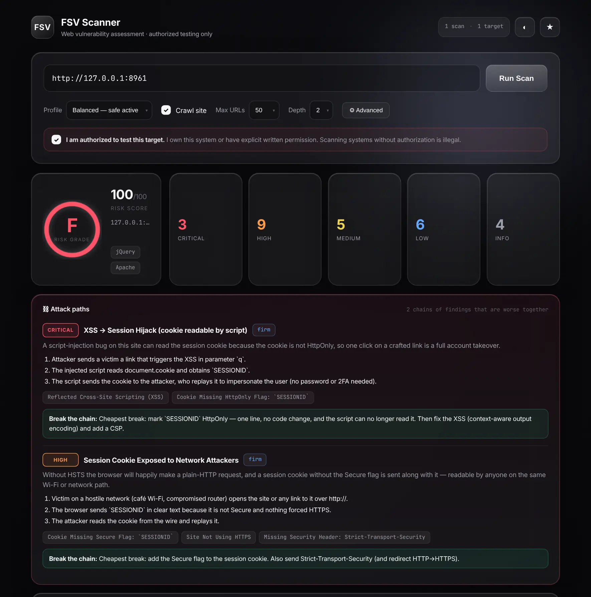
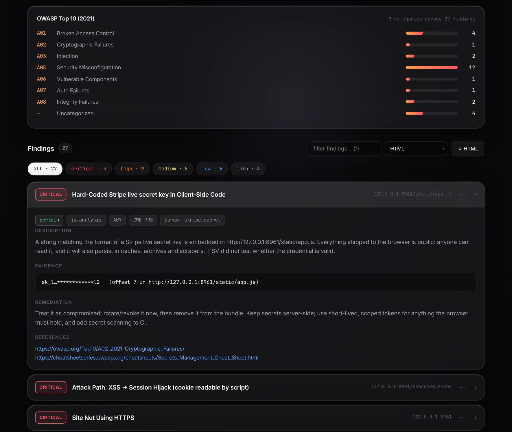
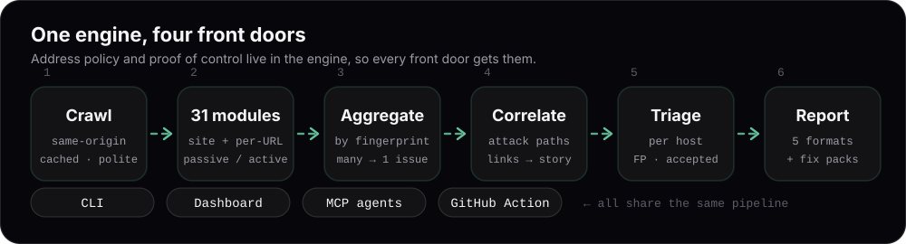

<p align="center">
  
</p>

<p align="center">
  <a href="https://github.com/twayst0/fsv/actions/workflows/ci.yml"></a>
  
  
  
  
  
  
</p>

<p align="center">
  <b>Web security scanner for the problems nobody is watching</b> — dangling DNS &amp; subdomain takeover, orphaned cloud buckets,
  compromised script CDNs, SPF includes that expired, debug mode left on, secrets in your JavaScript, end-of-life software,
  and the <b>attack paths</b> that turn small findings into a real compromise.<br>
  Runs as a <b>CLI</b>, a <b>dashboard</b>, an <b>MCP server</b> for AI agents, and a <b>CI step</b>.
</p>

<p align="center">
  <a href="#connect-your-ai-assistant-in-30-seconds">MCP in 30 s</a> ·
  <a href="#see-it-work">See it work</a> ·
  <a href="#what-it-finds-that-checklists-miss">What it finds</a> ·
  <a href="#attack-paths">Attack paths</a> ·
  <a href="#install">Install</a> ·
  <a href="#usage">Usage</a> ·
  <a href="#in-ci">CI</a> ·
  <a href="#fsv-and-owasp-zap">FSV &amp; ZAP</a> ·
  <a href="#limits--what-fsv-is-not">Limits</a> ·
  <a href="#documentation">Docs</a> ·
  <a href="#contact">Contact</a>
</p>

> ### ⚠ Authorized use only
> FSV is a security **assessment** tool. Use it **only** against systems you own or are **explicitly authorized in writing** to test. Scanning systems without permission is illegal in most jurisdictions. Every entry point (web, CLI, MCP, CI) requires you to confirm authorization, and a shared deployment can additionally require **proof of control** of the target before any payload is sent ([docs/DEPLOYMENT.md](docs/DEPLOYMENT.md)).

---

## Connect your AI assistant in 30 seconds

Point Claude, Cursor or VS Code at FSV and ask it to review **your** site. The assistant asks you to confirm
authorization, runs a passive check, then a full scan, leads with attack paths and hands you paste-ready fixes.

```bash
pip install fsv
fsv mcp-config --client claude-code     # prints:  claude mcp add fsv -- /path/to/fsv-mcp
fsv mcp-config --client claude-desktop  # or cursor · vscode — prints the JSON to paste
```

No install at all: with [uv](https://docs.astral.sh/uv/), point any MCP client at `uvx fsv mcp`
(`{ "command": "uvx", "args": ["fsv", "mcp"] }`). FSV is listed in the
[official MCP Registry](https://registry.modelcontextprotocol.io) as `io.github.twayst0/fsv`.

Then, in the assistant: *“Use the **security_review** prompt on https://my-shop.example — I own it.”*

<details>
<summary><b>MCP tools &amp; prompt</b></summary>

| Tool | Purpose |
|---|---|
| `fsv_scan` | Full scan — profiles, scope, time-box, `seed_urls`; `headers` / `cookies` for an authenticated scan with a test account |
| `fsv_quick_check` / `fsv_waf_check` | Passive posture check / WAF-CDN detection |
| `fsv_fixes` | Paste-ready nginx / apache / caddy / express / DNS remediation |
| `fsv_get_report` | md · json · html · sarif · csv · `fix-*` |
| `fsv_triage` | Mark false positive / accepted / fixed (persists per host) |
| `fsv_compare_scans` · `fsv_target_trend` | Before/after a fix · risk over time |
| `fsv_verify_ownership` | Proof of control (DNS TXT or HTTP file) for shared deployments |
| `fsv_list_scans` · `fsv_scan_stats` · `fsv_list_modules` | History · request stats · catalogue |

**Prompt** `security_review(target, server)` — the guided, authorization-first workflow above.
Scan results carry an `attack_paths` section so the agent leads with what matters. The server is tested
end to end over stdio (`tests/test_mcp_stdio.py`).
</details>

## See it work

<p align="center">
  
</p>

That output is **real** — a scan of the deliberately vulnerable demo site that ships in this repo. Reproduce it in a minute:

```bash
python examples/demo_site.py &                 # http://127.0.0.1:8961 — loopback only, fake secrets
fsv scan http://127.0.0.1:8961 --authorize
fsv web                                        # open the same scan in the dashboard
```
<sub>The `cloud_storage` check asks Amazon S3 whether the demo's bucket exists — that one request goes to AWS (read-only). Skip it with `--no-external`.</sub>

## What it finds that checklists miss

Plenty of tools tell you a header is missing. The incidents that actually hurt organisations — including very well-run ones — are quieter, and they live where nobody is looking.

<p align="center">
  
</p>

| | The problem | How FSV avoids crying wolf | Module |
|---|---|---|---|
| 🪝 | A **DNS record outlived its project** — anyone can claim the name and serve content from *your* domain | asks for the **CNAME explicitly** (an A lookup hides dangling aliases), follows the chain, and never treats a resolver *error* as "dangling" | `takeover` |
| 🪣 | A page loads a script from a **bucket that no longer exists** — whoever creates it controls your page | one `max-keys=1` request; objects are never fetched, nothing is created | `cloud_storage` |
| ✉️ | **SPF `include:` of an expired domain**, SPF over the **10-lookup limit**, a **512-bit DKIM key** | skips all DNS checks (with an explanation) if the domain itself doesn't resolve | `dns_security` |
| 🗺️ | **Source maps** and **hard-coded credentials** shipped to every visitor | credentials are reported **masked** and are never tested | `js_analysis` |
| 🧱 | **jQuery 3.3.1 / AngularJS 1.x / Vue 2** and **PHP 8.1** past end of support | dated tables — flagged the day support ends; version read from the URL without downloading third-party files | `js_libs` · `tech` |
| ⛓️ | **XSS + a session cookie without HttpOnly** = account takeover | only chains whose every link was found on *this* scan | `correlation` |

Details, and every false-positive guard: **[docs/DETECTIONS.md](docs/DETECTIONS.md)**.

## Attack paths

Real compromises are rarely one bug — they're two or three "medium" problems that line up. Scanners rate each in isolation, so the combination stays invisible until someone writes the incident report. FSV reads **its own findings** (sending nothing more) and, where a chain is actually present, adds a finding that names the links, tells the story step by step, and states **the cheapest single fix that breaks it**. If a link is triaged away, the chain steps aside automatically.

<p align="center">
  
</p>

| Chain | Why it is worse together |
|---|---|
| XSS **+** session cookie without HttpOnly | one crafted link = account takeover |
| no HSTS / no HTTPS **+** session cookie without Secure | session readable on any hostile network |
| takeover-able subdomain **+** session cookie scoped to the parent domain | whoever claims the subdomain receives your users' sessions |
| dangling SPF include **+** DMARC not enforcing | perfectly authenticated phishing as your domain |
| no SPF/DMARC enforcement at all | your domain can be spoofed |

## Dashboard

<p align="center">
  
</p>
<p align="center">
  
</p>

Liquid-glass UI with a live stepper (survives a page reload), the attack-path panel, OWASP breakdown, per-host risk trend, sort / module filters, **bulk triage**, one-click **re-scan**, keyboard navigation, scan comparison, and one-click export — reports **or paste-ready fixes**. Light and dark themes; no third-party requests.

## Features

- **Finds the pages first** — besides links: robots.txt, sitemaps, routes leaked by debug pages, and API paths quoted in your JavaScript; action-like paths are never requested. `--seed` for anything else.
- **A badge for your README** — `fsv badge <scan_id>` writes a dated grade badge (`FSV security | A · 2026-10-25`); regenerate it from CI.
- **Fix packs** — turn findings into **nginx / Apache / Caddy / Express / DNS** configuration (`fsv fixes <scan> nginx`). Only what was actually found; CSP is emitted report-only.
- **Notifications** — `--notify <webhook>` (or `FSV_WEBHOOK_URL`) posts the grade and the worst findings to Slack, Discord or your own endpoint. Evidence is never included.
- **CI-ready** — `fsv.toml`, **baselines** (gate only on *new* findings), `--fail-on`, SARIF for GitHub code scanning, and a ready-made **GitHub Action**.
- **Triage that sticks** — false positive / accepted risk / fixed / confirmed, stored per host by stable fingerprint, re-applied to later scans, excluded from the score. Diff any two scans; per-host trend.
- **Evidence over guesses** — exposure checks validate *content* (a `.git/HEAD` must look like one; an SPA that answers 200 to everything produces nothing). Every finding has a **confidence**, a CWE, an OWASP Top 10 (2021) category, impact and remediation.
- **Honest failure** — a crashing module is counted, explained and logged; a target that never answered is flagged, not graded "clean".
- **Safe by construction** — secrets masked at the source; cloud-metadata/link-local never reachable, loopback/RFC 1918 optionally blocked, on every lookup and redirect hop; dashboard CSRF/DNS-rebinding guard and token auth.
- **Extensible** — a module is one class; drop a file in `~/.fsv/plugins` or ship an entry-point package ([docs/WRITING_MODULES.md](docs/WRITING_MODULES.md)). Bring your own JS-library advisories and EOL dates.
- **Fast & polite, hard to stall** — async engine, shared HTTP client with cache, request coalescing, token-bucket rate limit, retries, size cap, time limit with partial results. A hanging endpoint costs one timeout per scan, not one per module; every response regex is linear-time. Tested against hostile local servers (redirect loops, 20 MB bodies, hangs, catch-all SPAs).
- **Five report formats** — Markdown (OWASP-grouped), JSON, self-contained HTML, SARIF 2.1, CSV.
- **Local-first** — results in a local SQLite file; the only optional third-party calls are listed in [DEPLOYMENT.md](docs/DEPLOYMENT.md#network-egress).

## Install

```bash
pip install fsv          # Python 3.11+  ·  pipx install fsv  keeps it isolated
fsv doctor               # checks Python, dependencies, DNS, database, plugins
```

From source: `git clone https://github.com/twayst0/fsv && cd fsv && ./install.sh` (or `pip install -e .`).

Requires **Python 3.11+**. Docker: see [docs/DEPLOYMENT.md](docs/DEPLOYMENT.md) (`docker compose up`).

## Usage

```bash
fsv scan example.com --authorize                       # full scan of a site you own
fsv scan example.com --authorize --profile passive     # read-only: no payloads sent
fsv web                                                # dashboard → http://127.0.0.1:7474
```

<details>
<summary><b>CLI reference</b></summary>

```bash
# scope & tuning
fsv scan example.com --authorize --exclude "/admin/*,/logout" --max-urls 100 --max-time 900 --tag prod
fsv scan example.com --authorize --header "Authorization: Bearer X" --cookie "session=abc"    # authenticated
fsv scan example.com --authorize --ct-logs        # also ask Certificate Transparency (crt.sh) for subdomains*
fsv scan example.com --authorize --no-external    # skip modules that contact hosts other than the target
fsv scan example.com --authorize --proxy env      # behind a corporate proxy (HTTPS_PROXY); or --proxy http://host:3128

# reports & fixes
fsv scan example.com --authorize -o report.html   # .md .json .html .sarif .csv
fsv report <scan_id> --format fix-nginx           # or fix-apache fix-caddy fix-express fix-dns
fsv fixes  <scan_id> nginx -o nginx-fixes.md

# triage, history, diff
fsv findings <scan_id>
fsv triage <scan_id> <finding_id> false_positive --note "test endpoint"
fsv list --target example.com   ·   fsv diff <before_id> <after_id>   ·   fsv prune --keep 50

# ownership proof (for shared deployments)           # * sends the domain name to crt.sh
fsv verify example.com   ·   fsv verify example.com --check

fsv modules   ·   fsv doctor
```
</details>

### In CI

```toml
# fsv.toml  (commit it; ${VAR} is read from the environment — never commit secrets)
[scan]
profile  = "balanced"
max_urls = 100
exclude  = ["/admin/*"]
max_time = 900
fail_on  = "high"
baseline = ".fsv-baseline.json"
[scan.headers]
Authorization = "Bearer ${FSV_API_TOKEN}"
```

```bash
fsv scan staging.example.com --authorize --write-baseline .fsv-baseline.json    # once: accept today's state
fsv scan staging.example.com --authorize                                         # every build: fails only on NEW high+ findings
```

```yaml
# .github/workflows/security.yml
- uses: twayst0/fsv@v2.2.1          # pin a release tag (or a commit SHA)
  with:
    target: https://staging.example.com
    authorized: "true"          # you confirm you may test this target
    profile: balanced
    fail-on: high
    baseline: .fsv-baseline.json
```
SARIF is uploaded to GitHub code scanning; the HTML report and log are attached as an artifact.

## FSV and OWASP ZAP

ZAP is the right tool for deep testing of an application's inputs — use it. FSV looks at what surrounds the
application, where typical DAST scans don't go, and the two work well side by side:

| Area | Typical DAST scan | FSV |
|---|---|---|
| DNS that outlived its project (dangling CNAME, unregistered targets) | out of scope | `takeover` |
| Buckets your pages load from that no longer exist | out of scope | `cloud_storage` |
| Scripts from compromised CDNs (polyfill.io 2024) or expired domains | out of scope | `supply_chain` |
| Email spoofing: SPF lookup limit, dead includes, DMARC, DKIM key size | out of scope | `dns_security` |
| Debug mode visible only on error pages (Django, Werkzeug, Ignition…) | partly | `debug_mode` |
| Several medium findings that add up to account takeover | listed separately | `correlation` attack paths |
| Fixes as server config, triage that persists, CI baselines, MCP | — | built in |
| Deep input fuzzing, authenticated spidering, scripted auth, JS-rendered apps | **yes** | basic |

## Modules (32)

FSV ships **32 modules** — 26 passive, 6 active. Run `fsv modules` for the live list.

<details>
<summary><b>The full catalogue</b> &nbsp;<sub>(or run <code>fsv modules</code>)</sub></summary>

| Module | Looks for | Kind |
|---|---|---|
| `takeover` | dangling CNAME / unclaimed SaaS resource / unregistered target domain | passive · site · ↗ |
| `cloud_storage` | orphaned or publicly-listable S3 / GCS / Azure buckets referenced by the site | passive · url · ↗ |
| `dns_security` | SPF (10-lookup limit, dead includes, `+all`), DMARC, DKIM key strength, MTA-STS, dead NS/MX, CAA, DNSSEC | passive · site |
| `js_analysis` | hard-coded credentials, exposed source maps, internal/non-prod hosts in client code | passive · url |
| `js_libs` | known-vulnerable & end-of-life JavaScript libraries | passive · url |
| `supply_chain` | scripts/styles from compromised or abandoned CDNs (polyfill.io, bootcdn, staticfile, rawgit) or from domains that are no longer registered | passive · url · ↗ |
| `debug_mode` | framework debug mode in production (Django `DEBUG=True`, Werkzeug console, Rails, Laravel Ignition, Symfony, Express, ASP.NET) — seen on error pages a crawler never visits | passive · site |
| `paths` | ~100 exposed files/endpoints, each content-validated (`.git`, `.env`, actuator, pprof, tfstate, backups…) | passive · site |
| `tech` | stack fingerprint + **end-of-life** software from a dated table | passive · site |
| `headers` · `csp_analyzer` | security headers · deep CSP review | passive |
| `ssl` | HTTPS, certificate validity, weak protocols/ciphers | passive · site |
| `cookies` | Secure / HttpOnly / SameSite / parent-domain scope | passive |
| `sri` · `mixed_content` · `clickjacking` · `form_security` · `csrf` | page-level hygiene | passive |
| `info_disclosure` · `dir_listing` · `http_methods` · `security_txt` · `waf_detect` · `graphql_introspection` · `jwt_analysis` · `subdomain` | exposure & recon | passive |
| `xss` · `sqli` · `ssti` · `open_redirect` · `cors` · `host_header_injection` | reflected/error-based/marker checks (benign payloads) | **active** |

↗ contacts hosts other than the target (skip with `--no-external`). `passive` = sends no crafted payloads. **Profiles:** `passive` (only passive modules), `balanced` (default), `aggressive` (higher rate/concurrency).
</details>

## How it works

<p align="center">
  
</p>

One engine, four front doors. Address policy and proof of control live in the engine, so every front door gets them; request guard and token auth belong to the web server. See [docs/ARCHITECTURE.md](docs/ARCHITECTURE.md).

<details>
<summary><b>Configuration (environment variables)</b></summary>

| Variable | Default | Purpose |
|---|---|---|
| `FSV_HOST` / `FSV_PORT` | `127.0.0.1` / `7474` | dashboard bind address |
| `FSV_DB` | `~/.fsv/scans.db` | SQLite database |
| `FSV_TOKEN` | — | shared secret required on every API / WebSocket call (`X-FSV-Token` or `?token=`) |
| `FSV_ALLOWED_HOSTS` | — | extra `Host` names the dashboard answers to (DNS-rebinding guard) |
| `FSV_BLOCK_PRIVATE` | off | refuse loopback / RFC 1918 targets (SSRF protection). Cloud-metadata ranges are *always* refused |
| `FSV_REQUIRE_VERIFICATION` | off | payload-sending scans only against hosts whose owner proved control |
| `FSV_MAX_SCANS` | `3` | concurrent scans |
| `FSV_DISABLED_MODULES` | — | comma-separated module names to turn off |
| `FSV_WEBHOOK_URL` / `FSV_WEBHOOK_MIN_SEVERITY` | — / `high` | POST a short summary (Slack/Discord-compatible) when a scan finds issues at or above that severity; same as `--notify URL` |
| `FSV_PLUGIN_DIR` / `FSV_NO_PLUGINS` | `~/.fsv/plugins` / off | plugin discovery |
| `FSV_ADVISORY_FILE` / `FSV_EOL_FILE` | — | your own JS-library advisories / end-of-life dates (JSON) |
</details>

## Limits — what FSV is *not*

* It reads HTML; it does **not execute JavaScript**, so content that only exists after client-side rendering isn't discovered.
* Active checks cover common reflected classes with benign markers. It is **not** a replacement for a penetration test, SAST or an SCA pipeline.
* The JS-advisory and end-of-life tables are curated snapshots — cross-check with OSV / endoflife.date for anything important, and extend them with the files above.
* DNS checks are only as good as the resolver (`fsv doctor` tests it). A resolver that can't answer produces *no* DNS findings, not bad ones.
* Findings carry a **confidence**; tentative ones are hints. Triage them, and tell us about false positives — they're the most useful bug reports.

## Documentation

[Detections](docs/DETECTIONS.md) · [Architecture](docs/ARCHITECTURE.md) · [Writing modules](docs/WRITING_MODULES.md) · [Deploying safely](docs/DEPLOYMENT.md) · [Security policy](SECURITY.md) · [Contributing](CONTRIBUTING.md) · [Changelog](CHANGELOG.md)

<sub>The animated SVGs and screenshots above are generated from a real scan: <code>scripts/build_readme_assets.sh --screenshots</code>.</sub>

## Contact

**twayst0 (tways)** — author and maintainer

- Email: **statways1707@gmail.com**
- Discord: **.tways**
- Security issues: please report privately (see [SECURITY.md](SECURITY.md)), not in a public issue.

Questions, collaboration and licensing enquiries are welcome by email or Discord.

## License

**MIT** — free to use, modify and share, for anyone, including commercially. Keep the copyright and licence
notice. Copyright © 2026 twayst0. See [LICENSE](LICENSE).

## Disclaimer

This software is provided "as is", for lawful, authorized security testing only.
The authors accept no liability for misuse or damage. Always obtain written
permission before testing any system you do not own.
